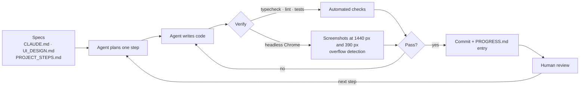
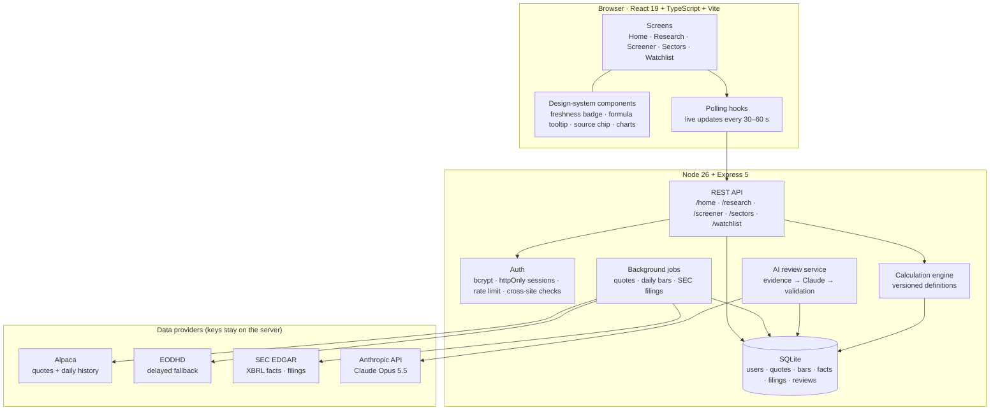
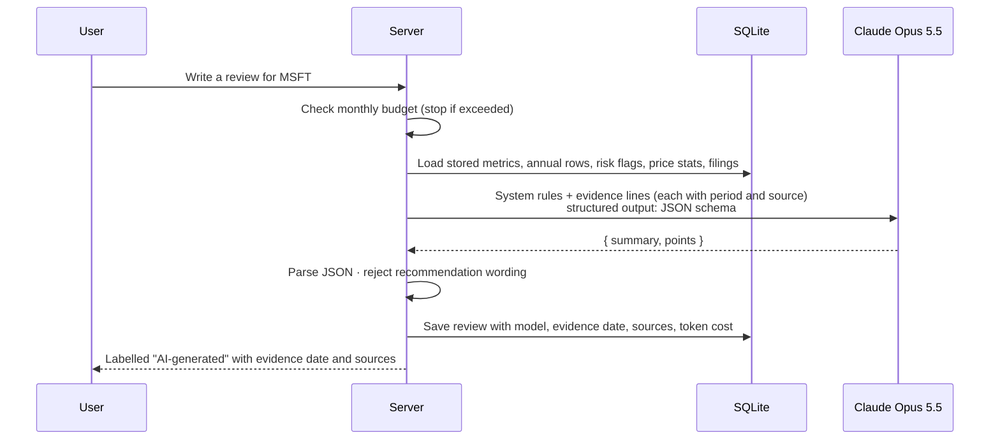
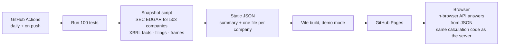

# US Stock Terminal

A research terminal for US stocks, built end to end with an **agentic AI workflow**: a coding agent (Claude Code) worked from written specifications, in gated steps, and checked its own work with tests and a real browser. The app also contains its own AI feature: Claude writes company research notes from verified evidence, inside strict guardrails.

**Live demo:** https://aswanth05.github.io/stockmarket_analysis/ (real SEC EDGAR data, rebuilt daily; no login, no prices)

   

---

## What it does

| Screen | What you see |
|---|---|
| **Home** | Market status in Eastern Time, S&P 500 / Dow / Nasdaq through ETF proxies, market breadth, sector breakdown, weekly sector returns, watchlist filings |
| **Stock Research** | Company financials from SEC filings, with every number's formula, inputs, period and filing ID on hover; factor scores; risk flags; AI review; daily candle chart with 50/200-day averages |
| **Stock Screener** | Filter the S&P 500 by sector, price, trend, revenue growth and margin |
| **Sector Analysis** | Price movement and business performance, kept as two separate views |
| **My Watchlist** | Saved per account, refreshing live |

It is a research tool: it never says "buy" or "sell", never shows delayed data as live, and never fills missing data with zero.

---

## How it was built: the agentic workflow

The project was not written prompt by prompt. It was run as a **spec-driven, step-gated agent loop**, with a human approving each stage.



### 1. Specifications as the agent's context
Three documents act as the agent's standing instructions, so every step works from the same rules:
- **[CLAUDE.md](CLAUDE.md)**: technical rules (US markets only, keys stay on the server, calculations in backend code, AI never computes numbers).
- **[UI_DESIGN.md](UI_DESIGN.md)**: screens, components, required states and accessibility rules.
- **[PROJECT_STEPS.md](PROJECT_STEPS.md)**: 44 ordered steps, each with a "Done when" test (for example, *"a weekend and a holiday both show closed"*).

### 2. Step gates with a human in the loop
Each step ended with the agent explaining its changes, running the checks and stopping for review. Decisions that belong to a person (which data to publish, hosting, legal exposure) were raised as explicit questions, not guessed. **[PROGRESS.md](PROGRESS.md)** records what changed, what was tested and what was left open at every step.

### 3. The agent verifies its own work
- **100 automated tests** written alongside the code: login gating, cookie flags, stale-data rules, the four financial calculations with zero and negative inputs, screener results against a manual check, AI budget limits, and a scan proving no API key appears in any response.
- **Browser verification:** the agent drove headless Chrome through the DevTools Protocol, logged in with a session cookie, took screenshots of every screen at desktop and phone widths, and measured page width to find layout overflow. That is how it found that screen-reader-only text inside scrolling tables was widening the phone layout.
- **Isolated test environments:** a separate server and throwaway database for end-to-end runs, so test accounts never touched the real one.
- **Real-data validation:** after the first live SEC download, the agent checked the numbers, found impossible profit margins (one REIT at 2964%), traced it to partial revenue lines in XBRL, fixed the extraction, and released the change as calculation version v1.1.

### 4. Safety built into the process
- Secrets live only in a git-ignored `server/.env` or in GitHub and hosting secret stores, never in code or commits.
- Staged changes were checked for keys and database files before every commit.
- A sub-agent fetched the official NYSE holiday calendar instead of the agent relying on memory.

---

## System architecture



### Data flow
1. **Ingest:** background jobs pull quotes every minute while the market is open, fill daily price history to the last trading day, and load SEC company facts and filings. Every provider call is logged (path, status, timing; never keys).
2. **Store:** every value keeps its own timestamp, source and feed type. A failed refresh keeps the last good value and marks it **stale** with the error.
3. **Calculate:** revenue growth, net margin, return on equity, free cash flow and moving averages are computed in backend code from versioned definitions, with explicit handling of zero and negative denominators.
4. **Explain:** every figure the browser receives carries its formula, inputs, period and source (for SEC data, the accession number of the filing).
5. **Present:** the UI shows freshness on every card and chart, and states plainly when data is missing.

---

## The AI feature: evidence-grounded research notes



Guardrails:
- **Grounded:** Claude only sees facts the backend already calculated and stored. It is told not to add numbers, dates or sources.
- **Constrained output:** a JSON schema through the API's structured-output mode, so responses are parsed, not scraped.
- **Validated:** any output using buy, sell or rating language is withheld and stored as rejected.
- **Cost-capped:** a monthly budget is required before the feature turns on; each call checks the worst-case cost first, and actual token cost is recorded.
- **Resilient:** server-side refusal fallback, so a declined request is retried on a suitable model within the same call.
- **Transparent:** every review shows its model, evidence date, status and sources.

---

## Public demo architecture

GitHub Pages cannot run a server, so the demo is a separate build of the same frontend:



- The demo runs the **same calculation, scoring and risk code** as the server: that code is shared, with no database dependency.
- It publishes only public-domain SEC data. Prices are left out because market-data terms do not allow republishing them on a public site.

---

## Technology

| Layer | Choices |
|---|---|
| Language | TypeScript (strict) across frontend, backend and shared types |
| Frontend | React 19, Vite 8, hand-built SVG charts (candles, volume, moving averages, donut, gauge, grouped bars), CSS design tokens with WCAG AA contrast tests |
| Backend | Node 26, Express 5, built-in `node:sqlite` with numbered migrations |
| Auth & security | bcrypt (12 rounds), hashed session tokens in httpOnly SameSite cookies, login rate limiting, custom-header and Origin checks against cross-site requests, security headers |
| Data | Alpaca (quotes, daily bars), EODHD (delayed fallback), SEC EDGAR (XBRL company facts, frames, submissions), stored NYSE holiday calendar |
| AI | Anthropic TypeScript SDK, Claude Opus 5.5, structured outputs, server-side refusal fallback |
| Quality | Vitest, Testing Library, Supertest, ESLint, Prettier, headless Chrome via DevTools Protocol |
| Delivery | npm workspaces (`shared`, `server`, `web`), GitHub Actions, GitHub Pages (demo), Render blueprint (private deployment) |

## Repository layout

```
shared/   Types for every API response, market-session logic, wording guard
server/   Express API, auth, providers, calculations, background jobs, AI service
  data/     Stored S&P 500 list and NYSE calendar
  scripts/  Data refresh and demo snapshot builders
web/      React app, components, charts, screens, demo mode
.github/  Pages workflow (tests → SEC snapshot → build → deploy)
```

## Run it locally

```sh
npm install
npm run dev     # API on :3001, app on http://localhost:5173
npm test        # 100 tests across shared, server and web
```

Data keys go in `server/.env` (see `.env.example`). Each source is optional; screens explain what is missing instead of guessing.
